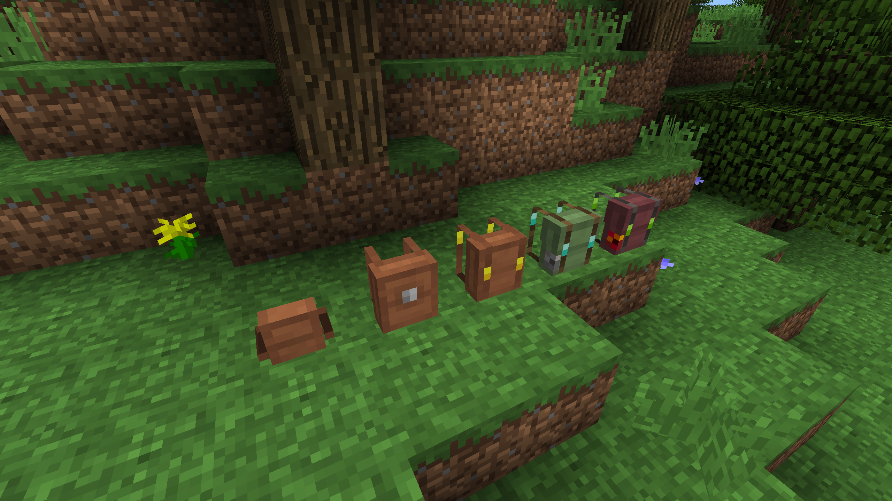
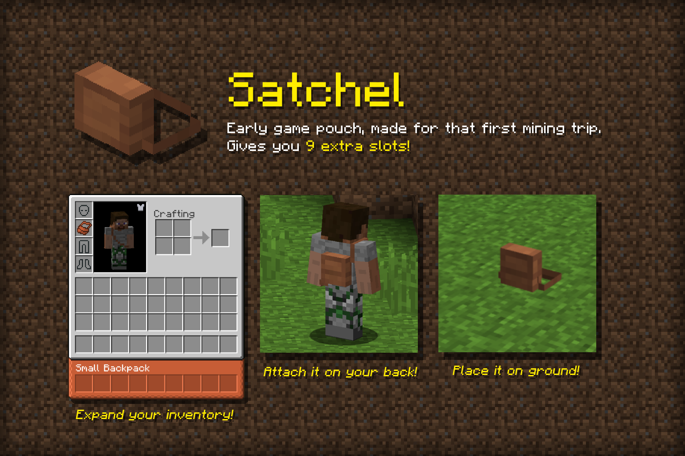
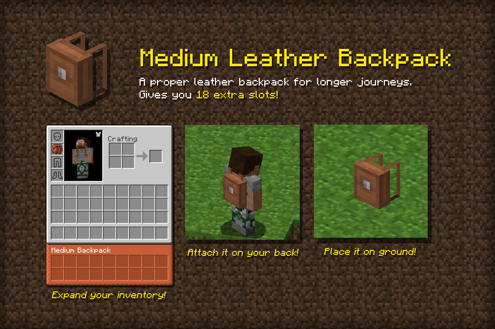
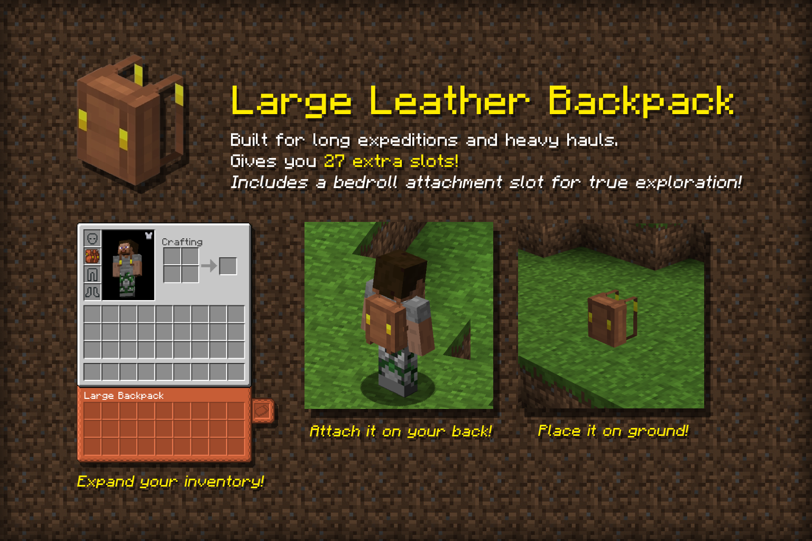
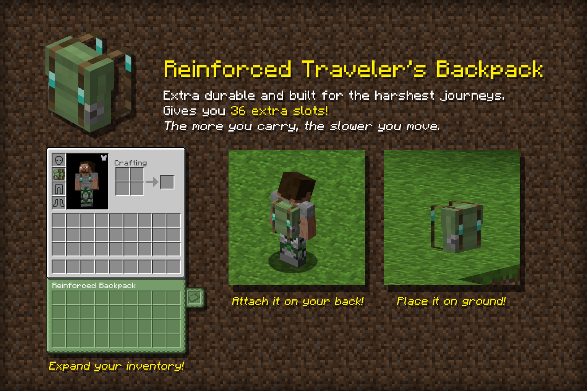
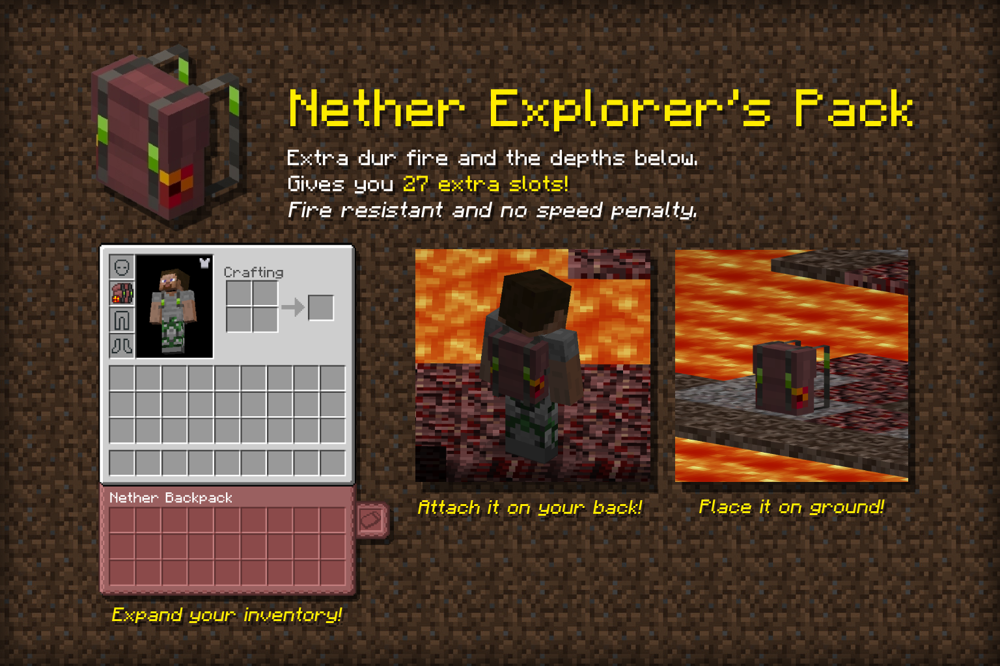
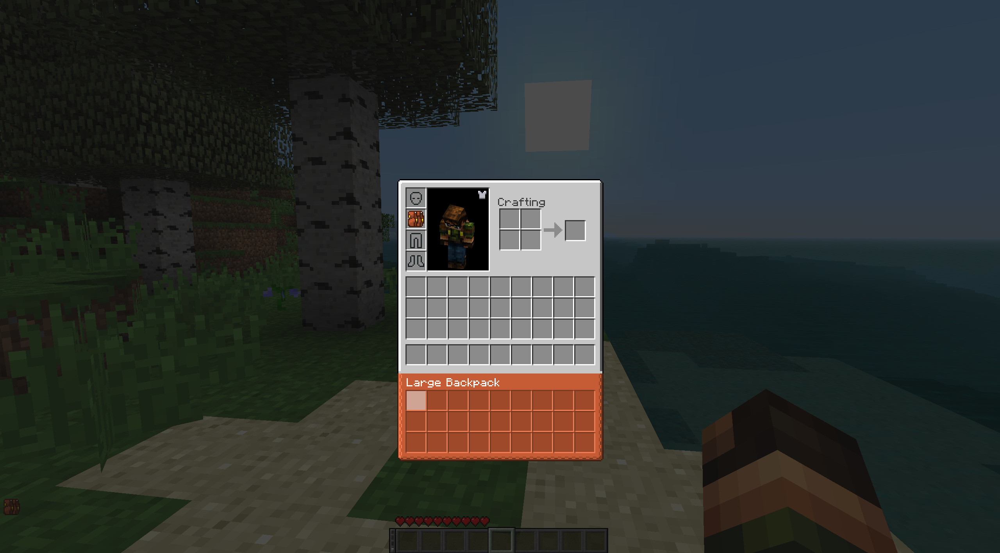
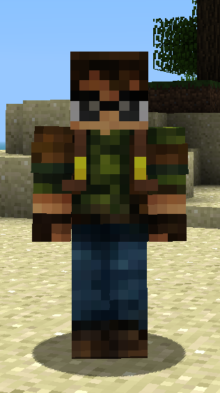
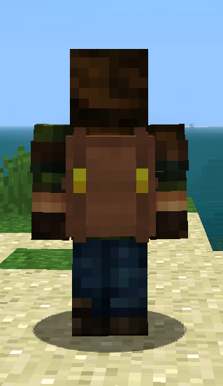
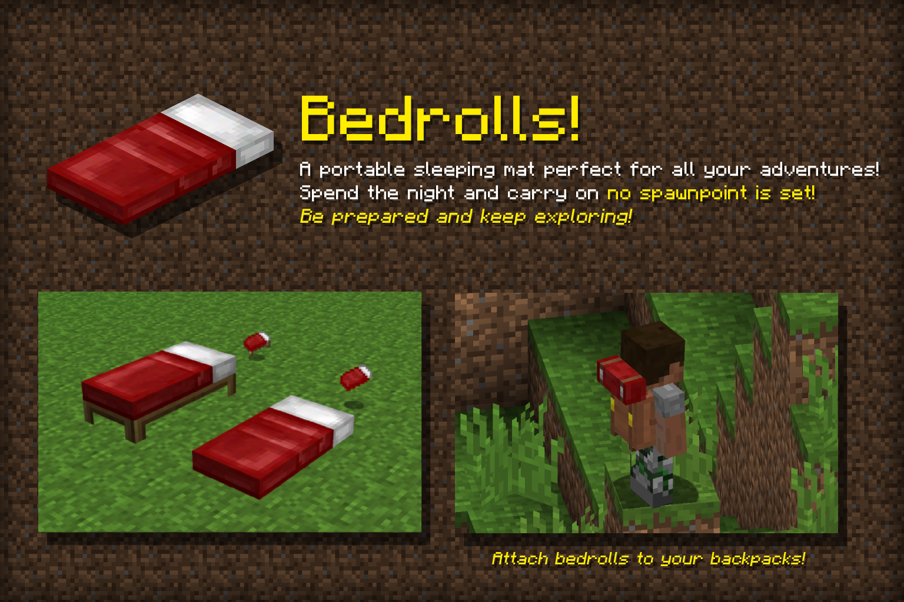

# Better With Bags

Backpacks for Better Than Adventure.

Wear a backpack in the chestplate slot and your inventory gets extra rows. Hold one in your hand to open it, or put it down in the world like a chest. Each tier is crafted from the one before it, and the recipes and textures are made to fit the rest of BTA.

Works in singleplayer and on servers.

  
   
  <em>All five backpacks, from the Small Leather Satchel to the Nether Explorer's Pack.</em>

## Backpacks

| Backpack | Slots | Bedroll slot | Movement |
|----------|-------|--------------|----------|
| Small Leather Satchel | 9 | no | normal |
| Medium Leather Backpack | 18 | no | normal |
| Large Leather Backpack | 27 | yes | up to 10% slower |
| Reinforced Traveler's Pack | 36 | yes | up to 15% slower |
| Nether Explorer's Pack | 27 | yes | normal, fireproof |

The slowdown depends on how full the backpack is. An empty backpack doesn't slow you down.

  
  
  
  
  

### Wearing

Put a backpack in the chestplate slot and its slots appear under your inventory, in creative too. The backpack is drawn on your back, with the bedroll if one is attached.

  
   
  <em>A worn Large Leather Backpack adds three rows under the inventory.</em>

  
  

### Holding

Right-click with a backpack in your hand to open it.

### Placing

Sneak and right-click a block to place the backpack. Right-click it to open it, or sneak and right-click to pick it back up. Breaking it drops the backpack with everything still inside.

### Upgrading

Craft a backpack together with the materials of the next tier to upgrade it. The contents, bedroll and name carry over.

### Bedroll

A bed you can carry. You sleep in it like in a normal bed, but it doesn't set your spawn. Like a normal bed, it explodes in the Nether. Large, Reinforced and Nether backpacks have a slot to carry one.

  

### Other details

- Rename a backpack with a label and the name shows in its screen, also when it is placed.
- The sort key sorts backpack contents.
- Dropped backpacks don't despawn.
- The Nether Explorer's Pack floats up out of lava.

## Requirements

- BTA == 8.0.1
- HalpLibe >= [6.2.0+8.0.1](https://github.com/Turnip-Labs/bta-halplibe/releases)
- Catalyst Core >= [3.0.5](https://github.com/MartinSVK12/catalyst/releases), also included in [Catalyst All](https://modrinth.com/mod/catalyst)

## Credits

- **badsbee** - GUI textures, model assets
- **Sour Zombo** - item textures

## License

See [LICENSE](LICENSE). Short version: free for personal use and free modpacks with attribution, no commercial use without permission.
